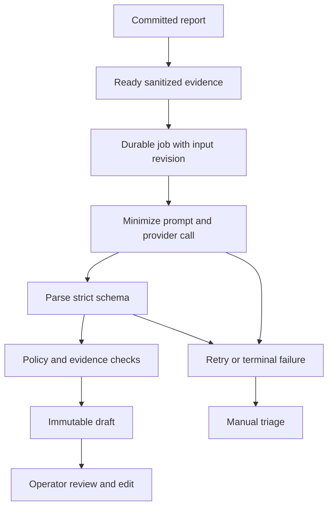

# AI pipeline and evaluation

TECH-05 | 2026-10-20 | Status: Proposed / research-based

[Other language / Bahasa lain](../../id/04-technical/ai-pipeline-and-evaluation.md)

Contents: [Recommendation and authority](#recommendation-and-authority) · [Processing pipeline](#processing-pipeline) · [Async failure policy](#async-failure-policy) · [Evaluation design](#evaluation-design) · [Dependencies and next action](#dependencies-and-next-action)

## Recommendation and authority

Use AI to draft structured intake, identify missing context and rank duplicate candidates. Operators approve category, priority, summary and assignment. Supervisors decide close-out. A model cannot certify a repair from before/after images, infer a hidden defect, or clear an emergency. It may point out what a supervisor should look at in those images, as an unverified hint that never changes status or blocks a decision (D-12). Visible emergency guidance precedes AI and uses the site's approved instructions.

Start with photo + Indonesian text and manual location. Defer autonomous tools and predictive maintenance. Voice and SAM segmentation were deferred too, until D-13 brought them forward for the hackathon. [Meta's current model catalogue](https://dev.meta.ai/docs/models) (T-12) describes model capabilities; it does not prove account access or field accuracy. Evaluate a Standard-mode Muse Spark adapter on the same cases as a manual baseline. Pin the exact model ID after a successful account probe. Record any unavailable capability rather than substituting a demonstration for a working API.

## Processing pipeline

Draft schema: `{ summary, visibleFacts:[{text,evidenceRefs}], userContext:[{text,reportRevision}], inferences:[{text,evidenceRefs,uncertainty}], missing_fields:[], categoryCandidate, priorityCandidate, priorityRationale, duplicateCandidates:[{ticketId,reason}], limitations:[] }`. Return `unknown` when evidence is insufficient. Location is copied only from user-selected location, never generated. Duplicate lookup is restricted to the same tenant/site and relevant time/category; candidate ticket IDs must resolve within that scope. Begin with SQL/text similarity before evaluating embeddings. Linking requires an operator action retaining all observations.

Store model/prompt/schema versions, input digest and revision, sanitized provider response, latency, retry count, token usage and human edits. Do not put reporter contact or access tokens in prompts. Treat photo text and report instructions as untrusted content, not tool instructions. No model has direct database mutation permission.

## Async failure policy

AI states: queued, running, succeeded, failed_retryable, failed_terminal, skipped_manual, cancelled. Work status remains submitted or its human-controlled successor. Proposed provider timeout 45 seconds and at most three attempts with exponential backoff/jitter, respecting Retry-After. Validate these values with actual latency and limits. A worker lease expires safely after a crash; deduplicate by report input revision and prompt/model version. A late draft is marked stale when human revision differs and cannot overwrite reviewed fields. Operators can skip or retry explicitly without resubmitting the report.

Use a circuit breaker and per-tenant quotas so repeated failures do not monopolize capacity. Bad credentials and invalid schemas after the bounded retry go to manual review. Record error class without sensitive provider payloads. Standard mode is the proposed real-data default; [Meta pricing terms](https://dev.meta.ai/docs/pricing-rate-limits) (T-11) distinguish it from Contributor mode, which trades content-training permission for discounts. Standard is not a blanket zero-retention or compliance promise.

## Evaluation design

| Measure | Method | Proposed gate |
| --- | --- | --- |
| Schema validity | Validate every result against schema | 100% accepted drafts valid; invalid output rejected |
| Draft correction | Operator changes material category/priority/summary | <=20% during agreed pilot evaluation |
| Routing safety | Compare reviewed first assignment and reassignment reasons | No increase in false routing relative matched baseline |
| Duplicate quality | Label candidate pairs; review false links and missed duplicates | >=90% precision on displayed candidates in evaluation set; human linking mandatory |
| Missing context | Annotated incomplete cases and operator usefulness rating | Report recall/errors by missing-field type; agree threshold before pilot |
| Unsupported claims | Human labels invented location, defect, completion or certainty | Zero critical unsupported safety/closure claims in release set |
| Latency/cost | Per job and end-to-end ready draft | Report p50/p95, timeout and cost; no unsourced SLA |

Prepare a proposed 60-case initial set plus 20 adversarial/failure cases using synthetic or permissioned content. Include dark/blurred photos, irrelevant images, visible people, Indonesian abbreviations, conflicting text/photo, duplicates with different angles and distinct issues at the same location. Split by incident/site, keeping near duplicates together; freeze a held-out set before prompt tuning. Two reviewers adjudicate disputed labels and log disagreement. Small synthetic results are descriptive and do not establish production accuracy.

Pilot timing separates operator active work, technician input burden and queue/parts/access waiting. Evaluate manual, shadow and limited-live phases on comparable categories. Corrected final tickets must not be mistaken for accurate raw model outputs. See [pilot measurement](../05-delivery/pilot-and-roi-validation.md).

## Dependencies and next action

A owns the versioned evaluation sheet and provider probe; Q co-labels and reviews user-visible limitations; P obtains permission for real examples. E proves job recovery and access boundaries. Do not enable real-data AI until privacy terms, data location, quotas, evaluation gates and manual fallback are agreed.
