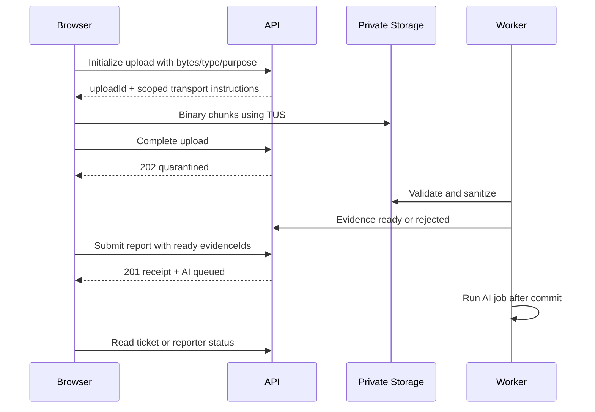

# API and event contracts

TECH-04 | 2026-10-20 | Status: Proposed / research-based

[Other language / Bahasa lain](../../id/04-technical/api-and-event-contracts.md)

Contents: [Contract conventions](#contract-conventions) · [Endpoint inventory](#endpoint-inventory) · [Types and examples](#types-and-examples) · [Secure receipt replay and draft schema](#secure-receipt-replay-and-draft-schema) · [Upload and async sequence](#upload-and-async-sequence) · [Events and errors](#events-and-errors) · [Dependencies and next action](#dependencies-and-next-action)

## Contract conventions

All paths below start with `/api/v1`. These are proposed contracts, not existing endpoints. Use JSON except the separate binary-upload transport. Member routes require a verified Supabase session, current tenant membership and site permission. Derive tenant from authenticated context; do not trust a client `tenantId`. Intake and reporter credentials authorize only their documented scope. Cookie mutations require origin/CSRF checks. Private responses use `Cache-Control: no-store`.

Use opaque UUIDs, RFC3339 UTC timestamps, schema version 1, and bounded cursor pagination with a proposed maximum 100 rows. All POST commands carry `Idempotency-Key`; member ticket commands also carry `expectedRevision`. Scope idempotency by tenant and actor/credential, retain a digest and sanitized original resource response for a proposed 24 hours; exclude raw reporter tokens from stored responses, and reject key reuse with a changed payload. A retry after that window must reconcile by request/report ID before creating new work.

## Endpoint inventory

| Method and path | Credential | Behavior |
| --- | --- | --- |
| POST `/intake/sessions` | Site intake code plus abuse controls | Short-lived site-scoped credential and upload quota; public QR is not member access |
| POST `/intake/reports` | Intake session | Atomically create observation, submitted ticket, token hash, event and outbox; 201 even if AI is pending |
| POST `/evidence/uploads` | Intake session or authorized member | Allocate immutable object path and upload lease; return transport instructions |
| GET `/evidence/uploads/{uploadId}` | Same scoped actor | Upload/validation state without public object URL |
| POST `/evidence/uploads/{uploadId}/complete` | Same scoped actor | Verify object exists, bytes/type/digest; enqueue validation, return 202 |
| DELETE `/evidence/uploads/{uploadId}` | Same scoped actor | Idempotent abort and cleanup request |
| GET `/tickets`, GET `/tickets/{ticketId}` | Member | Site-filtered list/detail; includes revision and allowed actions |
| POST `/tickets/{ticketId}/triage` | Operator/supervisor | Reviewed summary, category, priority, location; optionally reference AI draft |
| POST `/tickets/{ticketId}/duplicate-links` | Operator/supervisor | Human link or merge into target; preserve observations/history |
| DELETE `/tickets/{ticketId}/duplicate-links/{linkId}` | Operator/supervisor | Audited unlink with reason and expected revision |
| POST `/tickets/{ticketId}/assignments` | Operator/supervisor | Assign/reassign atomically; current-assignee rules apply |
| POST `/tickets/{ticketId}/transitions` | Authorized workflow actor | Only edges allowed by state guard; reason/assignment as required |
| POST `/tickets/{ticketId}/completion-submissions` | Current assignee | Immutable attempt with ready proof; enter completion_submitted |
| POST `/tickets/{ticketId}/verifications` | Supervisor | Accept or reject current attempt with evidence review |
| POST `/reporter-status/session` | Raw reporter bearer secret in body | Exchange for restricted HttpOnly session; never log raw body |
| GET `/reporter-status` | Restricted reporter session | Sanitized own-report status and clarification question |
| POST `/reporter-status/clarifications` | Restricted session with clarify scope | Append answer to own report; operator reviews before state change |
| POST `/exports`, GET `/exports/{exportId}` | Explicit export permission | Async scoped CSV job, expiry and short signed download |

Media viewing uses an authorized evidence reference returned in ticket detail; the server may issue a five-minute signed download after rechecking scope. This does not make media public. Exact signed-download implementation is internal until the upload spike proves the provider's semantics.

## Types and examples

```ts
type AIState = 'queued' | 'running' | 'succeeded' | 'failed_retryable'
  | 'failed_terminal' | 'skipped_manual' | 'cancelled';
type UploadState = 'initialized' | 'uploading' | 'quarantined'
  | 'scanning' | 'ready' | 'rejected' | 'expired' | 'aborted';
type Command = { expectedRevision: number; reason?: string };
type VerificationCommand = Command & {
  completionSubmissionId: string;
  decision: 'accept' | 'reject';
  reason: string;
  reviewedEvidenceIds: string[];
};
type IntakeResult = {
  reportId: string; ticketId: string; revision: number;
  status: 'submitted'; ai: { jobId: string; state: AIState };
  reporterToken: string; receiptGeneration: number;
};
```

Example intake body: `{ "siteId":"uuid", "locationText":"Floor 2, west corridor", "description":"Water below pipe", "evidenceIds":["uuid"], "noticeVersion":"v1" }`. Require text, manual location and at least one ready photo for the demo path; a configurable text-only accessible intake must be reviewed before pilot use. Never infer a precise location from the image. A verification rejection requires a nonempty reason; acceptance requires the current pending attempt and its required evidence, not just an `accept` string.

## Secure receipt replay and draft schema

The resource mutation is idempotent; receipt-secret issuance is an explicit rotation exception. Never persist the raw `reporterToken` in an idempotency record, outbox, event, cache or log. On a lost-response retry, require the same still-valid intake credential, same Idempotency-Key and same request digest, bound to the one original report. Lock that record, return the existing report/ticket IDs, revoke the former reporter credential and sessions, generate a fresh 32-byte token, store only its hash and increment `receiptGeneration`. Return the raw replacement only in that no-store response. Concurrent retries serialize; only the highest receiptGeneration is valid. The client discards older generations and retries exchange if a late response carries a revoked receipt. Propose at most three rotations within the original 30-minute intake lease, with per-credential throttling. The 24-hour idempotency record does not extend that lease. After expiry/rotation cap, use the documented operator recovery process, not unauthenticated token issuance. Record `reporter_credential.rotated.v1` without its secret.

Exact AI draft v2 fields: `{ summary, visibleFacts:[{text,evidenceRefs}], userContext:[{text,reportRevision}], inferences:[{text,evidenceRefs,uncertainty}], missing_fields:[], categoryCandidate, priorityCandidate, priorityRationale, duplicateCandidates:[{ticketId,reason}], limitations:[], damagePhrase }`. `damagePhrase` is a short noun phrase naming the visible damage, used only to outline it (D-13), and may be empty. Fact/inference references must resolve to the authorized input evidence. User context refers to the source report revision. Missing information remains explicit, and priority has an operator-reviewable rationale. This is the shared AC-02/AC-19 wire schema.

Exact AI proof check fields (D-12): `{ sameLocation:'same'|'different'|'unclear', reportedProblem:'not_visible'|'still_visible'|'unclear', observations:[], missingProof:[], limitations:[] }`. It runs once per completion attempt that has a photo, only while the attempt is pending and the report has a photo to compare with. No field states that a repair is done or that proof should be accepted.

Both verification decisions require a nonempty reason. A category proof exception may create a pending supervisor review with `proofExceptionReason`, checklist results and proposed alternate proof; `verified_closed` still requires approved ready evidence. A failed upload is never alternate proof.

## Upload and async sequence



Proposed limits: JPEG/PNG/WebP, 10 MB/file, maximum three intake and three completion images, no video/audio in core. Check actual bytes and decoded image dimensions, not filename/MIME alone. TUS is a resumable chunked transport, distinct from JSON and S3 multipart. A small-file multipart adapter can be evaluated but must use the same initialize/complete/validate rules. Do not include base64 photos in ticket JSON. [Supabase TUS documentation](https://supabase.com/docs/guides/storage/uploads/resumable-uploads) (T-04) describes resumable uploads, current 6 MB chunk guidance and upload URLs valid up to 24 hours. The proposed application lease is 30 minutes; provider credential TTL and revocation need verification. Expiry blocks attachment even if an orphan object later arrives. Do not promise immediate revocation of an already issued provider URL.

Lost networks resume the same upload where supported. Renew credentials only after checking ownership and lease; expired uploads restart with a new object ID. `complete` is idempotent. Never use upsert on evidence. Keep the original submission key across a lost HTTP response, and query/retry before showing success. Scheduled cleanup removes aborted/expired orphans.

## Events and errors

Envelope: `{ eventId, eventType, schemaVersion:1, tenantId, aggregateId, aggregateRevision, occurredAt, actor:{type,id}, correlationId, causationId, payload }`. Proposed event types: `reporter_credential.rotated.v1`, `report.submitted.v1`, `report.clarification_requested.v1`, `report.clarified.v1`, `evidence.ready.v1`, `evidence.rejected.v1`, `ai.draft_ready.v1`, `ai.failed.v1`, `ticket.triaged.v1`, `ticket.duplicate_linked.v1`, `ticket.duplicate_unlinked.v1`, `ticket.assignment_changed.v1`, `ticket.status_changed.v1`, `ticket.completion_submitted.v1`, `ticket.verification_decided.v1`, `ticket.reopened.v1`, `export.ready.v1`, `privacy.deletion_requested.v1`, `privacy.deletion_completed.v1`. Privacy payloads contain references and class counts, not deleted personal content.

Events and outbox commit with domain mutations. Consumers deduplicate by eventId; external sends use a delivery record and provider key where available. Ordering is per ticket revision, not global. Archive/retry cannot claim exactly-once external effects. Merge locks both tickets in stable ID order; it cannot silently cancel work. Reconcile missed outbox entries and quarantine poison jobs.

Error envelope: `{ error:{code,message,details,requestId,retryable} }`. Use 400 malformed, 401 invalid member session, 403 known-scope forbidden, 404 missing or inaccessible resource, 409 stale revision/idempotency or upload conflict, 413 too large, 415 unsupported media, 422 domain/evidence guard, 429 throttled with Retry-After, 503 transient dependency. Public token failures use a uniform unavailable response. Avoid leaking SQL, secrets, signed URLs or other tenants in details.

## Dependencies and next action

E owns an OpenAPI draft and command schemas; A owns adapter normalization; Q checks negative scenarios and wording. Resolve upload credential TTL, transactional queue behavior and token recovery in the spike. Contracts must pass [quality scenarios](../05-delivery/quality-and-acceptance.md) before any real pilot data. Version breaking changes under a new API/event version and retain a migration window.
