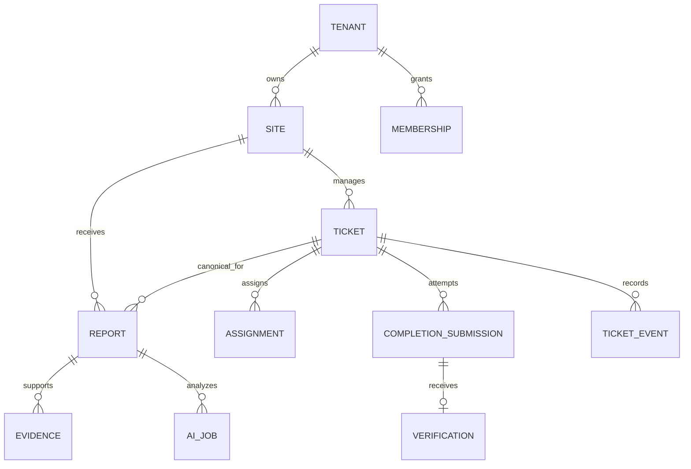

# Domain and data model

TECH-02 | 2026-10-20 | Status: Proposed / research-based

[Other language / Bahasa lain](../../id/04-technical/domain-and-data-model.md)

Contents: [Recommendation and invariants](#recommendation-and-invariants) · [Relationships](#relationships) · [Constraints and transactions](#constraints-and-transactions) · [Retention and counting](#retention-and-counting) · [Dependencies and next action](#dependencies-and-next-action)

## Recommendation and invariants

A report is an observation; a ticket is managed work. Several reports may support one ticket. Preserve every observation through duplicate linking, cancellation and reopening. Use opaque UUIDs, UTC timestamps with site timezone for display, and `tenant_id` on every tenant-owned row. Unpredictable IDs supplement authorization.

| Entity | Minimum fields | Invariant |
| --- | --- | --- |
| Tenant, Site, Location | id, tenant_id, timezone, active | Manual location required within selected site |
| Membership | tenant_id, user_id, role, site_scope, active | Current membership controls access |
| Report | id, tenant_id, site_id, location_id/text, text, revision, canonical_ticket_id | Original observation retained; corrections versioned |
| Ticket | id, tenant_id, site_id, status, revision, category, priority | State and revision change together |
| Assignment | ticket_id, technician_id, assigned_by, accepted_at, ended_at | At most one active assignment per ticket |
| Upload, Evidence | tenant_id, object_key, bytes, digest, purpose, validation_state | Only `ready` evidence satisfies completion |
| CompletionSubmission | ticket_id, assignment_id, evidence_ids, note, submitted_by | Immutable attempt, retained after rejection |
| Verification | completion_id, decision, reason, verifier_id, at | One decision per pending attempt |
| DuplicateLink | source_ticket_id, target_ticket_id, reason, actor_id, active | Same tenant/site; no self-link or directed cycle |
| AIJob, AIDraft | report_id, input_revision, model, prompt_version, state, draft | Late result cannot overwrite newer human decisions |
| TicketEvent, Outbox | event_id, tenant_id, ticket_id, seq, type, actor, payload_version | Append-only business history; retry by event_id |
| ReporterCredential | token_hash, report_id, scope, expiry, revoked_at, receipt_generation | Raw bearer secret is never stored/logged |

## Relationships

## Constraints and transactions

Use composite foreign keys `(tenant_id,ticket_id)` to `(tenant_id,id)`, including evidence and assignments. Index `(tenant_id,site_id,status,updated_at)`, `(tenant_id,ticket_id,seq)`, current membership and due outbox jobs. Enforce unique event sequence, one pending completion and a partial unique active assignment. Store unique `(tenant_id,actor_scope,idempotency_key)` with request digest and sanitized resource response excluding receipt secrets; a changed payload with the same key returns 409.

A command locks its ticket, rechecks current membership and expected revision, validates the edge and evidence, inserts event and outbox, increments revision, then commits. [PostgreSQL row locks](https://www.postgresql.org/docs/18/explicit-locking.html) (T-07, reviewed via Context7) support serialization of conflicting writers. Recheck conditions after acquiring the lock. No model call or upload runs inside this transaction.

Apply RLS and narrow SQL grants to tables, views and Storage, alongside application authorization. Administrative secret credentials bypass RLS, so worker queries still require tenant predicates and composite keys. [Supabase RLS documentation](https://supabase.com/docs/guides/database/postgres/row-level-security) (T-03) describes this boundary.

## Retention and counting

Separate optional reporter contact from work records. Deletion may remove evidence and redact personal payloads while retaining an agreed non-identifying audit tombstone. Append-only does not justify indefinite personal-data retention. A governed deletion event records which classes were removed.

A human merge updates report canonical-ticket relations with history. Preserve original IDs, former links, timestamps and completion attempts. Cancel redundant work only through an explicit cancellation after checking active assignments. Count observations as report volume and canonical work units as tickets; merging observations is not a repaired asset. A reopened ticket remains the same work unit with a new cycle, enabling reopen-rate analysis.

## Dependencies and next action

E drafts migrations and fixtures for two tenants. Q validates domain terms; P agrees category/location dictionaries and retention with the data owner. Exercise late AI, reassignment, unlinking and delete/restore before schema approval. [State guards](state-machine-and-permissions.md) and [API contracts](api-and-event-contracts.md) govern behavior above these tables.
