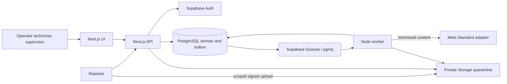

# High-level design

TECH-01 | 2026-10-20 | Status: Proposed / research-based

[Other language / Bahasa lain](../../id/04-technical/high-level-design.md)

Contents: [Recommendation and scope](#recommendation-and-scope) · [Components and trust boundaries](#components-and-trust-boundaries) · [Stack comparison](#stack-comparison) · [Failure and deployment decisions](#failure-and-deployment-decisions) · [Dependencies and next action](#dependencies-and-next-action)

## Recommendation and scope

Use a TypeScript Next.js modular monolith for the UI and `/api/v1`, a separate Node worker, and Supabase Auth, PostgreSQL and private Storage. Two managed container services separate slow AI jobs from requests. Modules share a repository and domain model; this is deployment separation, not a microservices architecture. This recommendation is conditional on a technical spike and team skills, neither of which has been validated.

Target one commercial building site in Indonesia and 2-4 non-emergency corrective-maintenance categories. The product supports evidence intake and supervisor-verified close-out. It does not replace an ERP/CMMS or determine physical safety. Show site emergency guidance before uploading, independent of AI.

## Components and trust boundaries

| Module | Responsibility | Boundary |
| --- | --- | --- |
| Intake | Report, session, receipt | Public credential is restricted to one intake |
| Work management | Ticket, assignment, state guard, verification | Current member, tenant and site checked per command |
| Evidence | Upload lease, validation, access | No public bucket or browser provider secret |
| AI assistance | Versioned draft and evaluation | Cannot assign, close, or overwrite human decisions |
| Integration | Outbox, notifications, CSV | External failure does not undo accepted work |

Perform authorization inside the server-only data-access layer used by SSR, Route Handlers and Server Actions. A protected page does not protect a direct mutation. Return minimal DTOs, following [Next.js guidance](https://nextjs.org/docs/app/guides/authentication) (T-01). Apply [Supabase SSR guidance](https://supabase.com/docs/guides/auth/server-side/nextjs) (T-02) for verified claims and cookie refresh; never share-cache authenticated responses.

## Stack comparison

| Candidate | Benefit | Tradeoff | Decision |
| --- | --- | --- | --- |
| Next.js + Node + Supabase | Shared types and one runtime language | Team skills, extension and hosting compatibility unknown | Reference choice after spike |
| Next.js + FastAPI + PostgreSQL | Python specialist libraries | Two runtimes and duplicated validation/operations | Revisit for a Python-only production need |
| Request-only serverless | Small deployment surface | Long model/media work and retries can outlive requests | Keep durable worker |
| Microservices + Redis | Independent scaling | More services, secrets and failure modes | Defer until measured need |

Evaluate [Supabase Queues](https://supabase.com/docs/guides/queues) (T-05), built on pgmq, before writing a custom queue. Its delivery claim applies within a visibility window; side effects still need idempotency across retries. Validate transactional enqueue and extension availability; use an outbox reconciliation path.

## Failure and deployment decisions

Report persistence succeeds even when AI is queued or fails; the operator can triage manually. Incomplete or quarantined uploads cannot satisfy completion evidence. Persist ticket changes, immutable events and outbox in one transaction, with external calls after commit. Keep synthetic demo data, staging fixtures and pilot data separate.

Singapore is a candidate because [Render lists the region](https://docs.render.com/regions) (T-10). Co-location, Supabase availability, transfer terms and customer approval remain gates. Pin versions after compatibility checks. See [contracts](api-and-event-contracts.md), [security](security-privacy-and-governance.md) and [costs](infrastructure-and-costs.md).

## Dependencies and next action

E owns a one-day spike covering verified SSR, cross-tenant denial, private upload, transactional queued job, worker restart and manual fallback. P obtains data-owner requirements; A verifies provider account access. Record results in [architecture decisions](architecture-decisions.md). If access fails, use clearly labelled simulated AI on synthetic data for the demo; never claim a live integration.
