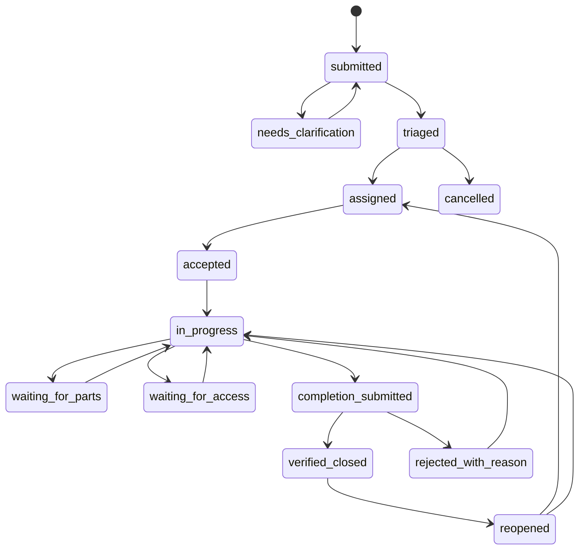

# State machine and permissions

TECH-03 | 2026-10-20 | Status: Proposed / research-based

[Other language / Bahasa lain](../../id/04-technical/state-machine-and-permissions.md)

Contents: [Decision](#decision) · [Transition guards](#transition-guards) · [Permissions](#permissions) · [Conflict and failure behavior](#conflict-and-failure-behavior) · [Dependencies and next action](#dependencies-and-next-action)

## Decision

Use the exact work-status identifiers below. AI and upload states are separate axes. A duplicate is a relationship, never a terminal status. Only supervisor acceptance produces `verified_closed`; technician submission and model output cannot do so. This is a proposed workflow, not safety certification.

## Transition guards

| From | To | Actor and required condition |
| --- | --- | --- |
| submitted | needs_clarification | Operator; specific missing context and question |
| needs_clarification | submitted | Operator after response; retain original observation |
| submitted | triaged | Operator; manual location, category, priority, summary reviewed |
| triaged | assigned | Operator; active same-site technician |
| assigned | accepted | Current assigned technician, assignment ID |
| accepted | in_progress | Assigned technician, start acknowledgement |
| in_progress | waiting_for_parts / waiting_for_access | Assigned technician, reason and next review time |
| waiting_for_parts / waiting_for_access | in_progress | Assigned technician, resume note |
| in_progress | completion_submitted | Assigned technician, ready completion evidence and note |
| completion_submitted | verified_closed | Supervisor who did not submit the attempt, current pending attempt, evidence reviewed, decision reason |
| completion_submitted | rejected_with_reason | Supervisor who did not submit the attempt, reason and requested correction |
| rejected_with_reason | in_progress | Assigned technician acknowledges rejection |
| verified_closed | reopened | Supervisor, reason and prior verification reference |
| reopened | assigned | Operator, new/renewed assignment |
| reopened | in_progress | Supervisor, existing active assignee confirms availability |

Cancellation is additionally allowed from submitted, needs_clarification, triaged, assigned, accepted, in_progress, waiting_for_parts, waiting_for_access, rejected_with_reason and reopened. Operator/supervisor provides a reason, ends the active assignment and triggers notification. From completion_submitted, reject first; from verified_closed, reopen first. The diagram omits these extra cancellation edges for readability.

Reassignment is a separate command allowed from assigned, accepted, in_progress, either waiting state, rejected_with_reason and reopened. It atomically ends the old assignment and sets status to assigned. The former technician immediately loses write authority. Pending completion blocks reassignment until the supervisor resolves that attempt.

## Permissions

| Operation | Reporter | Operator | Assigned technician | Supervisor | Tenant admin |
| --- | --- | --- | --- | --- | --- |
| Submit report | Intake scope | Yes | As member | Yes | Yes |
| View | Sanitized own report | Site scope | Assigned work | Site scope | Site scope |
| Triage, link duplicates, assign | No | Yes | No | Yes | Explicit operator role |
| Progress and completion | No | No | Yes | Only when assigned separately | No implied right |
| Verify, reject, reopen | No | No | No | Yes | Explicit supervisor role |
| Members, retention settings | No | No | No | No | Yes, audited |
| Export | No | Explicit site permission | No | Explicit site permission | Explicit export permission |

Prefer a different person to verify work. Where staffing prevents separation, record self-verification as an exception and obtain pilot-owner agreement. Report it separately and do not call it independent verification. Tenant administration does not imply work-verification authority.

## Conflict and failure behavior

Every command includes `expectedRevision`. A stale command returns 409 and the current revision/actions, without silently applying a changed user decision. Concurrent accept/reject of one completion yields one committed decision. Immutable rejected attempts remain visible; correction creates a new attempt.

Late AI results are suggestions labelled with input revision. Failed AI leaves the work state unchanged and allows manual triage. Reporter clarification does not change status until operator review. Tokens cannot reopen or assign. Failed/expired tokens return an indistinguishable unavailable response without confirming ticket existence. A failed upload cannot become proof or trigger completion.

## Dependencies and next action

E centralizes guards; Q prepares scenarios for every allowed edge and forbidden actor. P confirms site authority to verify, cancel and approve exceptions. [API contracts](api-and-event-contracts.md) must expose commands rather than an unrestricted status patch. The acceptance review must cover rejection, resubmission, reopen, reassignment and conflicting commands, as well as the happy path.
