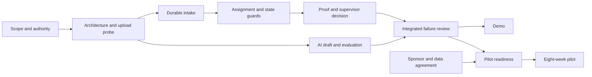

# Work breakdown and estimates

DEL-02 | 2026-10-20 | Status: Proposed / research-based

[Other language / Bahasa lain](../../id/05-delivery/work-breakdown-and-estimates.md)

Contents: [Estimation basis](#estimation-basis) · [Four-role demo workload](#four-role-demo-workload) · [Two-person scope](#two-person-scope) · [Critical path and pilot effort](#critical-path-and-pilot-effort) · [Dependencies and next action](#dependencies-and-next-action)

## Estimation basis

All effort is an analyst planning assumption, not a delivery quote or observed team velocity. Assume five focused project hours per available person per work day, leaving meetings and normal interruptions outside that block. Ten days yield 50 hours/person: 100 for two people or 200 for four. Availability, skills and existing components are unknown. Re-estimate after the architecture/provider probe.

## Four-role demo workload

| Work package | P hours | E hours | A hours | Q hours | Dependency |
| --- | --- | --- | --- | --- | --- |
| Scope, permission, synthetic story | 8 | 2 | 0 | 4 | Start |
| Architecture/provider spike | 0 | 6 | 4 | 2 | Scope |
| Intake and private upload | 0 | 10 | 2 | 4 | Spike |
| Manual workflow and verified close-out | 2 | 10 | 0 | 6 | Domain and intake |
| AI draft and evaluation | 2 | 4 | 18 | 4 | Ready evidence + provider |
| Duplicate relation, receipt, minimum dashboard | 2 | 4 | 4 | 4 | Workflow |
| Failure, privacy and acceptance review | 2 | 4 | 4 | 10 | Integrated slice |
| Demo pack, buyer/pilot preparation | 16 | 2 | 2 | 2 | Evidence and rehearsal |
| Total | 32 | 42 | 34 | 36 | 144 focused hours |

At 50 hours per role, reserve is P18/E8/A16/Q14 = 56 hours. E's eight hours, not the total reserve, constrain the technical path. A proposed uncertainty band of 120-200 total hours does not imply any individual owner can exceed 50. If E requires 60, the schedule slips or scope changes even when P has spare time. Cross-role help requires actual skills and handover cost.

## Two-person scope

Combine P+Q and E+A. The full table would load them at 68 and 76 hours, exceeding 50 each. The reduced plan targets 40 and 44 hours respectively, leaving 10 and six hours reserve.

| Reduced technical work | E+A hours | Reduced product/quality work | P+Q hours |
| --- | --- | --- | --- |
| Spike | 6 | Scope, permission, synthetic fixtures | 8 |
| Intake/private photo path | 10 | Mobile workflow and wording review | 8 |
| State, assignment, proof, review | 14 | Failure/access acceptance review | 12 |
| One AI draft path with fallback | 4 | Demo, buyer and pilot readiness pack | 12 |
| Manual duplicate relation | 2 | Total | 40 |
| Scoped receipt/minimum counts | 4 | | |
| Failure corrections | 4 | | |
| Total | 44 | | |

This is a narrow synthetic demonstration with two categories. Defer automatic duplicate ranking, rich analytics, broad notification channels, integrations, voice, segmentation and production recovery setup. Human review, private media, scoped access, proof and reject/reopen remain core. If a real AI path does not fit, label simulation and record the unmet integration gate; never imply production readiness.

## Critical path and pilot effort

Additional readiness after demo: P16-30, E40-70, A12-24, Q24-40 hours, total 92-164. This includes real RBAC, privacy/deletion, recovery rehearsal, timing, notifications, training and corrections. At 25 focused hours/role/week, E alone implies 1.6-2.8 work weeks, before sequential waiting. Two-person E+A requires 52-94 hours, or 2.1-3.8 weeks at that capacity. The [90-day roadmap](implementation-roadmap.md) is feasible only near favorable assumptions; otherwise move the start and preserve the full eight-week pilot.

Pilot support/measurement planning: P3-5, E2-4, A2-3, Q4-6 hours/week, total 11-18 or 88-144 over eight weeks. Customer operator/technician/supervisor labor is additional and must be measured separately. Salaries, opportunity cost, tax and contractor rates remain unknown; effort times a confirmed rate is the cost equation, not invented payroll.

Readiness plus eight-week support/measurement totals 180-308 hours, excluding the 144-hour demo. At an explicitly assumed Rp100,000/hour this is Rp18,000,000-30,800,000 of labor/opportunity cost. Adding the business model's Rp3,880,000 two-month cash service scenario gives Rp21,880,000-34,680,000 before other costs, leaving Rp16,880,000-29,680,000 to fund against a Rp5,000,000 fee test. This is a learning/investment decision, not a margin claim. Separate reusable product investment from customer-specific delivery and do not double-count overlapping staffing lines. The narrower 28-hour commercial sensitivity does not fund this full plan. See [unit economics](../02-business/unit-economics-and-costs.md).

## Dependencies and next action

P records named availability and skill coverage. E decomposes the spike results into remaining tasks; Q records acceptance evidence rather than ticket completion percentages. Review owner load and blocking dependencies at days 2/5/8, then before pilot. Keep one acceptance reviewer available; reduce optional scope before consuming recovery/security work. See [RACI](team-and-raci.md) and [risks](risk-register.md).
