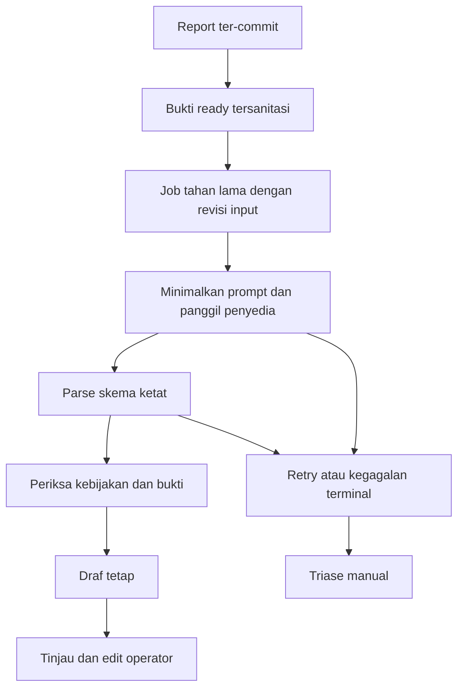

# Pipeline AI dan evaluasi

TECH-05 | 2026-10-20 | Status: Proposed / research-based

[Other language / Bahasa lain](../../en/04-technical/ai-pipeline-and-evaluation.md)

Daftar isi: [Rekomendasi dan kewenangan](#rekomendasi-dan-kewenangan) · [Pipeline pemrosesan](#pipeline-pemrosesan) · [Kebijakan kegagalan async](#kebijakan-kegagalan-async) · [Rancangan evaluasi](#rancangan-evaluasi) · [Ketergantungan dan tindakan berikutnya](#ketergantungan-dan-tindakan-berikutnya)

## Rekomendasi dan kewenangan

Gunakan AI untuk menyusun draf intake terstruktur, menemukan konteks yang kurang, dan mengurutkan kandidat duplikat. Operator menyetujui kategori, prioritas, ringkasan, serta penugasan. Supervisor memutuskan penutupan. Model tidak dapat mengesahkan perbaikan dari foto sebelum/sesudah, menyimpulkan kerusakan tersembunyi, atau menyatakan darurat selesai. Model boleh menunjukkan hal yang perlu diperhatikan supervisor pada foto tersebut, sebagai petunjuk belum terverifikasi yang tidak pernah mengubah status atau menghalangi keputusan (D-12). Panduan darurat terlihat sebelum AI dan menggunakan instruksi site yang disetujui.

Mulai dengan foto + teks Indonesia dan lokasi manual. Tunda tool otonom dan pemeliharaan prediktif. Suara dan segmentasi SAM juga semula ditunda, sampai D-13 memajukannya untuk hackathon. [Katalog model Meta saat ini](https://dev.meta.ai/docs/models) (T-12) menjelaskan kemampuan model; bukan bukti akses akun atau akurasi lapangan. Evaluasi adapter Muse Spark mode Standard dengan kasus sama seperti baseline manual. Tetapkan ID model tepat setelah probe akun berhasil. Catat kemampuan yang tidak tersedia, jangan mengganti API yang bekerja dengan demonstrasi.

## Pipeline pemrosesan

Skema draf: `{ summary, visibleFacts:[{text,evidenceRefs}], userContext:[{text,reportRevision}], inferences:[{text,evidenceRefs,uncertainty}], missing_fields:[], categoryCandidate, priorityCandidate, priorityRationale, duplicateCandidates:[{ticketId,reason}], limitations:[] }`. Kembalikan `unknown` bila bukti kurang. Lokasi hanya disalin dari lokasi pilihan pengguna, tidak dihasilkan model. Pencarian duplikat dibatasi tenant/site sama dan waktu/kategori relevan; ID kandidat tiket wajib ditemukan dalam scope itu. Mulai dengan kemiripan SQL/teks sebelum mengevaluasi embedding. Pengaitan memerlukan tindakan operator yang mempertahankan seluruh pengamatan.

Simpan versi model/prompt/skema, digest dan revisi input, respons penyedia tersanitasi, latensi, jumlah retry, pemakaian token, dan edit manusia. Jangan masukkan kontak pelapor atau token akses ke prompt. Perlakukan teks dalam foto dan instruksi report sebagai konten tidak tepercaya, bukan instruksi tool. Model tidak memiliki izin mutasi database langsung.

## Kebijakan kegagalan async

Status AI: queued, running, succeeded, failed_retryable, failed_terminal, skipped_manual, cancelled. Status pekerjaan tetap submitted atau penerus yang dikendalikan manusia. Usulan timeout penyedia 45 detik dan maksimum tiga percobaan dengan backoff eksponensial/jitter, mengikuti Retry-After. Validasi nilai ini dengan latensi dan batas nyata. Izin worker berakhir aman setelah crash; deduplikasi berdasarkan revisi input report serta versi prompt/model. Draf terlambat ditandai usang jika revisi manusia berbeda dan tidak menimpa kolom yang telah ditinjau. Operator dapat melewati atau mengulang secara eksplisit tanpa mengirim report ulang.

Gunakan circuit breaker dan kuota per tenant agar kegagalan berulang tidak menghabiskan kapasitas. Kredensial salah dan skema tidak valid setelah retry terbatas masuk tinjauan manual. Catat kelas kesalahan tanpa payload penyedia sensitif. Standard adalah usulan default data nyata; [ketentuan harga Meta](https://dev.meta.ai/docs/pricing-rate-limits) (T-11) membedakannya dari Contributor, yang menukar izin pelatihan konten dengan diskon. Standard bukan janji menyeluruh tentang retensi nol atau kepatuhan.

## Rancangan evaluasi

| Ukuran | Metode | Usulan gerbang |
| --- | --- | --- |
| Validitas skema | Validasi setiap hasil terhadap skema | 100% draf diterima valid; keluaran tidak valid ditolak |
| Koreksi draf | Operator mengubah kategori/prioritas/ringkasan material | <=20% selama evaluasi pilot yang disepakati |
| Keamanan routing | Bandingkan penugasan pertama ditinjau dan alasan pengalihan | Tidak menaikkan salah routing dibanding baseline sepadan |
| Kualitas duplikat | Label pasangan kandidat; tinjau salah kait dan duplikat terlewat | >=90% presisi kandidat tampil pada set evaluasi; pengaitan manusia wajib |
| Konteks hilang | Kasus tidak lengkap beranotasi dan penilaian kegunaan operator | Laporkan recall/kesalahan per tipe kolom; sepakati ambang sebelum pilot |
| Klaim tanpa dukungan | Manusia memberi label lokasi, cacat, penyelesaian, kepastian rekaan | Nol klaim kritis keamanan/penutupan tanpa dukungan dalam set rilis |
| Latensi/biaya | Per job dan draf ready ujung ke ujung | Laporkan p50/p95, timeout, biaya; tanpa SLA tak bersumber |

Siapkan usulan 60 kasus awal ditambah 20 kasus adversarial/kegagalan memakai konten sintetis atau berizin. Sertakan foto gelap/kabur, gambar tidak relevan, orang terlihat, singkatan Indonesia, konflik teks/foto, duplikat dari sudut berbeda, dan masalah berbeda pada lokasi sama. Pisahkan berdasarkan insiden/site dengan duplikat dekat tetap satu kelompok; bekukan set held-out sebelum penyetelan prompt. Dua peninjau menyelesaikan label sengketa dan mencatat ketidaksetujuan. Hasil sintetis kecil bersifat deskriptif dan tidak membuktikan akurasi produksi.

Waktu pilot memisahkan kerja aktif operator, beban input teknisi, dan waktu tunggu antrean/suku cadang/akses. Evaluasi fase manual, shadow, dan langsung terbatas pada kategori sepadan. Tiket akhir yang dikoreksi tidak boleh dianggap sebagai keluaran mentah model yang akurat. Lihat [pengukuran pilot](../05-delivery/pilot-and-roi-validation.md).

## Ketergantungan dan tindakan berikutnya

A memiliki lembar evaluasi berversi dan probe penyedia; Q ikut memberi label serta meninjau batas yang terlihat pengguna; P memperoleh izin contoh nyata. E membuktikan pemulihan job dan batas akses. Jangan aktifkan AI data nyata sampai ketentuan privasi, lokasi data, kuota, gerbang evaluasi, dan alur manual disepakati.
