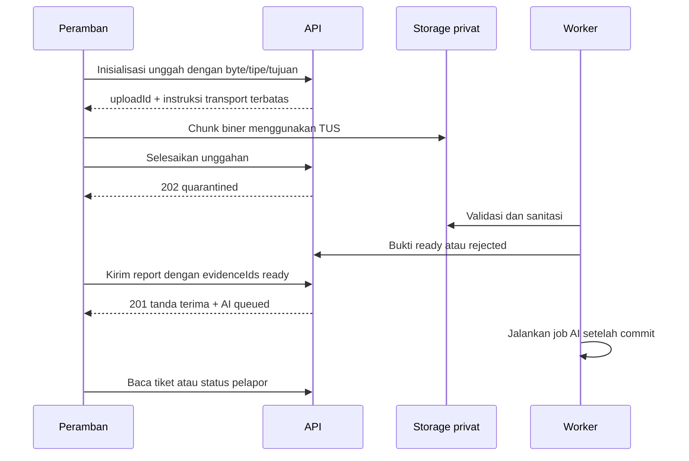

# Kontrak API dan event

TECH-04 | 2026-10-20 | Status: Proposed / research-based

[Other language / Bahasa lain](../../en/04-technical/api-and-event-contracts.md)

Daftar isi: [Konvensi kontrak](#konvensi-kontrak) · [Daftar endpoint](#daftar-endpoint) · [Tipe dan contoh](#tipe-dan-contoh) · [Replay tanda terima aman dan skema draf](#replay-tanda-terima-aman-dan-skema-draf) · [Urutan unggahan dan async](#urutan-unggahan-dan-async) · [Event dan kesalahan](#event-dan-kesalahan) · [Ketergantungan dan tindakan berikutnya](#ketergantungan-dan-tindakan-berikutnya)

## Konvensi kontrak

Semua path di bawah diawali `/api/v1`. Ini usulan kontrak, bukan endpoint yang sudah ada. Gunakan JSON kecuali transport unggahan biner terpisah. Rute anggota memerlukan sesi Supabase terverifikasi, keanggotaan tenant terkini, dan izin site. Turunkan tenant dari konteks autentikasi; jangan percaya `tenantId` klien. Kredensial intake dan pelapor hanya mengizinkan scope terdokumentasi. Mutasi cookie memerlukan pemeriksaan origin/CSRF. Respons privat memakai `Cache-Control: no-store`.

Gunakan UUID opak, timestamp UTC RFC3339, versi skema 1, dan paginasi cursor terbatas dengan usulan maksimum 100 baris. Semua perintah POST membawa `Idempotency-Key`; perintah tiket anggota juga membawa `expectedRevision`. Batasi idempotensi per tenant dan aktor/kredensial, simpan digest serta respons sumber awal yang disaring selama usulan 24 jam; keluarkan token pelapor mentah dari respons tersimpan, dan tolak pemakaian kunci sama untuk payload berubah. Retry setelah jendela itu harus merekonsiliasi ID permintaan/report sebelum membuat pekerjaan baru.

## Daftar endpoint

| Metode dan path | Kredensial | Perilaku |
| --- | --- | --- |
| POST `/intake/sessions` | Kode intake site serta kontrol penyalahgunaan | Kredensial site singkat dan kuota unggah; QR publik bukan akses anggota |
| POST `/intake/reports` | Sesi intake | Atomik membuat pengamatan, tiket submitted, hash token, event, outbox; 201 meski AI menunggu |
| POST `/evidence/uploads` | Sesi intake atau anggota berwenang | Alokasikan path objek tetap dan izin unggah; kembalikan instruksi transport |
| GET `/evidence/uploads/{uploadId}` | Aktor dengan scope sama | Status unggah/validasi tanpa URL objek publik |
| POST `/evidence/uploads/{uploadId}/complete` | Aktor dengan scope sama | Periksa objek, byte/tipe/digest; antrekan validasi, hasilkan 202 |
| DELETE `/evidence/uploads/{uploadId}` | Aktor dengan scope sama | Pembatalan idempoten dan permintaan pembersihan |
| GET `/tickets`, GET `/tickets/{ticketId}` | Anggota | Daftar/detail tersaring site; menyertakan revisi dan tindakan yang diizinkan |
| POST `/tickets/{ticketId}/triage` | Operator/supervisor | Ringkasan, kategori, prioritas, lokasi yang ditinjau; opsional referensi draf AI |
| POST `/tickets/{ticketId}/duplicate-links` | Operator/supervisor | Kait atau gabung ke target oleh manusia; pertahankan pengamatan/riwayat |
| DELETE `/tickets/{ticketId}/duplicate-links/{linkId}` | Operator/supervisor | Lepas kaitan diaudit dengan alasan dan revisi harapan |
| POST `/tickets/{ticketId}/assignments` | Operator/supervisor | Tugaskan/ulang secara atomik; aturan teknisi terkini berlaku |
| POST `/tickets/{ticketId}/transitions` | Aktor alur kerja berwenang | Hanya transisi yang diizinkan penjaga; alasan/assignment sesuai kebutuhan |
| POST `/tickets/{ticketId}/completion-submissions` | Teknisi terkini | Upaya tetap dengan bukti ready; masuk completion_submitted |
| POST `/tickets/{ticketId}/verifications` | Supervisor | Terima atau tolak upaya terkini setelah meninjau bukti |
| POST `/reporter-status/session` | Rahasia bearer pelapor mentah dalam body | Tukar dengan sesi HttpOnly terbatas; jangan mencatat body mentah |
| GET `/reporter-status` | Sesi pelapor terbatas | Status report sendiri yang disaring dan pertanyaan klarifikasi |
| POST `/reporter-status/clarifications` | Sesi terbatas dengan scope clarify | Tambah jawaban pada report sendiri; operator meninjau sebelum perubahan status |
| POST `/exports`, GET `/exports/{exportId}` | Izin ekspor eksplisit | Job CSV async terbatas, masa berlaku, unduh bertanda tangan singkat |

Tampilan media memakai referensi bukti berwenang dari detail tiket; server dapat memberi unduhan bertanda tangan lima menit setelah memeriksa scope ulang. Media tidak menjadi publik. Implementasi tepat unduhan bertanda tangan tetap internal sampai spike unggahan membuktikan semantik penyedia.

## Tipe dan contoh

```ts
type AIState = 'queued' | 'running' | 'succeeded' | 'failed_retryable'
  | 'failed_terminal' | 'skipped_manual' | 'cancelled';
type UploadState = 'initialized' | 'uploading' | 'quarantined'
  | 'scanning' | 'ready' | 'rejected' | 'expired' | 'aborted';
type Command = { expectedRevision: number; reason?: string };
type VerificationCommand = Command & {
  completionSubmissionId: string;
  decision: 'accept' | 'reject';
  reason: string;
  reviewedEvidenceIds: string[];
};
type IntakeResult = {
  reportId: string; ticketId: string; revision: number;
  status: 'submitted'; ai: { jobId: string; state: AIState };
  reporterToken: string; receiptGeneration: number;
};
```

Contoh body intake: `{ "siteId":"uuid", "locationText":"Floor 2, west corridor", "description":"Water below pipe", "evidenceIds":["uuid"], "noticeVersion":"v1" }`. Wajibkan teks, lokasi manual, dan minimal satu foto ready pada alur demo; intake aksesibel hanya teks yang dapat dikonfigurasi perlu ditinjau sebelum pilot. Jangan menyimpulkan lokasi tepat dari gambar. Penolakan verifikasi memerlukan alasan tidak kosong; penerimaan memerlukan upaya terkini yang menunggu dan bukti wajibnya, bukan sekadar string `accept`.

## Replay tanda terima aman dan skema draf

Mutasi sumber idempoten; penerbitan rahasia tanda terima adalah pengecualian rotasi eksplisit. Jangan menyimpan `reporterToken` mentah pada catatan idempotensi, outbox, event, cache, atau log. Retry respons hilang wajib memakai kredensial intake sama yang masih valid, Idempotency-Key sama, dan digest permintaan sama yang terikat pada satu report awal. Kunci catatan, kembalikan ID report/tiket yang ada, cabut kredensial serta sesi pelapor lama, hasilkan token 32 byte baru, simpan hash saja, dan naikkan `receiptGeneration`. Kembalikan pengganti mentah hanya pada respons no-store itu. Retry bersamaan diserialisasi; hanya receiptGeneration tertinggi valid. Klien membuang generasi lebih tua dan mengulang pertukaran bila respons terlambat membawa tanda terima dicabut. Usulkan maksimum tiga rotasi dalam izin intake awal 30 menit dengan pembatasan per kredensial. Catatan idempotensi 24 jam tidak memperpanjang izin itu. Setelah kedaluwarsa/batas rotasi, pakai proses pemulihan operator terdokumentasi, bukan penerbitan token tanpa autentikasi. Catat `reporter_credential.rotated.v1` tanpa rahasianya.

Kolom tepat draf AI v2: `{ summary, visibleFacts:[{text,evidenceRefs}], userContext:[{text,reportRevision}], inferences:[{text,evidenceRefs,uncertainty}], missing_fields:[], categoryCandidate, priorityCandidate, priorityRationale, duplicateCandidates:[{ticketId,reason}], limitations:[], damagePhrase }`. `damagePhrase` adalah frasa benda singkat yang menyebut kerusakan terlihat, hanya dipakai untuk menandainya (D-13), dan boleh kosong. Referensi fakta/inferensi wajib ditemukan pada bukti input berwenang. Konteks pengguna mengacu revisi report sumber. Informasi hilang tetap eksplisit dan prioritas memiliki alasan dapat ditinjau operator. Ini skema wire bersama AC-02/AC-19.

Kolom tepat pemeriksaan bukti AI (D-12): `{ sameLocation:'same'|'different'|'unclear', reportedProblem:'not_visible'|'still_visible'|'unclear', observations:[], missingProof:[], limitations:[] }`. Pemeriksaan berjalan sekali per upaya penyelesaian yang memiliki foto, hanya selama upaya menunggu dan laporan memiliki foto pembanding. Tidak ada kolom yang menyatakan perbaikan selesai atau bukti sebaiknya diterima.

Kedua keputusan verifikasi memerlukan alasan tidak kosong. Pengecualian bukti kategori dapat membuat tinjauan supervisor menunggu dengan `proofExceptionReason`, hasil checklist, dan usulan bukti alternatif; `verified_closed` tetap memerlukan bukti ready disetujui. Unggahan gagal bukan bukti alternatif.

## Urutan unggahan dan async



Usulan batas: JPEG/PNG/WebP, 10 MB/file, maksimum tiga gambar intake dan tiga penyelesaian, tanpa video/audio di inti. Periksa byte nyata dan dimensi hasil decode, bukan nama file/MIME saja. TUS adalah transport chunk yang dapat dilanjutkan, berbeda dari JSON dan S3 multipart. Adapter multipart file kecil dapat dievaluasi, tetapi wajib memakai aturan initialize/complete/validate yang sama. Jangan masukkan foto base64 dalam JSON tiket. [Dokumentasi TUS Supabase](https://supabase.com/docs/guides/storage/uploads/resumable-uploads) (T-04) menjelaskan unggah berlanjut, panduan chunk 6 MB saat ini, dan URL unggah berlaku hingga 24 jam. Usulan izin aplikasi berlaku 30 menit; TTL kredensial penyedia dan pencabutannya perlu diverifikasi. Kedaluwarsa memblokir penautan meski objek yatim datang kemudian. Jangan menjanjikan pencabutan segera URL penyedia yang sudah diterbitkan.

Jaringan terputus melanjutkan unggahan sama bila didukung. Perbarui kredensial hanya setelah memeriksa kepemilikan dan izin; unggahan kedaluwarsa mulai lagi dengan ID objek baru. `complete` idempoten. Jangan gunakan upsert untuk bukti. Pertahankan kunci pengiriman awal ketika respons HTTP hilang, lalu kueri/retry sebelum menampilkan keberhasilan. Pembersihan terjadwal menghapus objek yatim dibatalkan/kedaluwarsa.

## Event dan kesalahan

Envelope: `{ eventId, eventType, schemaVersion:1, tenantId, aggregateId, aggregateRevision, occurredAt, actor:{type,id}, correlationId, causationId, payload }`. Usulan tipe event: `reporter_credential.rotated.v1`, `report.submitted.v1`, `report.clarification_requested.v1`, `report.clarified.v1`, `evidence.ready.v1`, `evidence.rejected.v1`, `ai.draft_ready.v1`, `ai.failed.v1`, `ticket.triaged.v1`, `ticket.duplicate_linked.v1`, `ticket.duplicate_unlinked.v1`, `ticket.assignment_changed.v1`, `ticket.status_changed.v1`, `ticket.completion_submitted.v1`, `ticket.verification_decided.v1`, `ticket.reopened.v1`, `export.ready.v1`, `privacy.deletion_requested.v1`, `privacy.deletion_completed.v1`. Payload privasi berisi referensi dan jumlah kelas, bukan konten pribadi yang dihapus.

Event dan outbox di-commit bersama mutasi domain. Konsumen melakukan deduplikasi berdasarkan eventId; pengiriman eksternal memakai catatan pengiriman dan kunci penyedia bila ada. Urutan berdasarkan revisi per tiket, bukan global. Arsip/retry tidak boleh diklaim sebagai efek eksternal exactly-once. Merge mengunci kedua tiket dalam urutan ID tetap; tidak boleh membatalkan pekerjaan diam-diam. Rekonsiliasi outbox terlewat dan karantina job bermasalah.

Envelope kesalahan: `{ error:{code,message,details,requestId,retryable} }`. Gunakan 400 format salah, 401 sesi anggota tidak valid, 403 scope dikenal tetapi dilarang, 404 sumber hilang/tidak dapat diakses, 409 revisi/idempotensi usang atau konflik unggah, 413 terlalu besar, 415 media tidak didukung, 422 syarat domain/bukti, 429 dibatasi dengan Retry-After, 503 dependensi sementara gagal. Kegagalan token publik memakai respons tidak tersedia seragam. Hindari SQL, rahasia, URL bertanda tangan, atau tenant lain dalam detail.

## Ketergantungan dan tindakan berikutnya

E memiliki draf OpenAPI dan skema perintah; A memiliki normalisasi adapter; Q memeriksa skenario negatif dan bahasa. Selesaikan TTL unggah, antrean transaksional, dan pemulihan token dalam spike. Kontrak wajib lulus [skenario kualitas](../05-delivery/quality-and-acceptance.md) sebelum data pilot nyata. Perubahan tidak kompatibel memakai versi API/event baru dan jendela migrasi.
