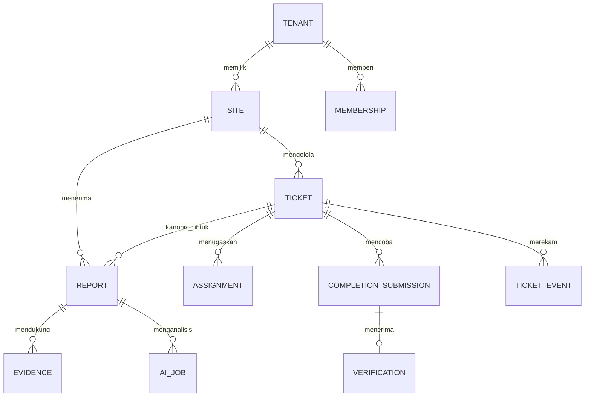

# Model domain dan data

TECH-02 | 2026-10-20 | Status: Proposed / research-based

[Other language / Bahasa lain](../../en/04-technical/domain-and-data-model.md)

Daftar isi: [Rekomendasi dan invarian](#rekomendasi-dan-invarian) · [Hubungan](#hubungan) · [Constraint dan transaksi](#constraint-dan-transaksi) · [Retensi dan penghitungan](#retensi-dan-penghitungan) · [Ketergantungan dan tindakan berikutnya](#ketergantungan-dan-tindakan-berikutnya)

## Rekomendasi dan invarian

Report adalah pengamatan; ticket adalah pekerjaan yang dikelola. Beberapa report dapat mendukung satu ticket. Pertahankan semua pengamatan saat pengaitan duplikat, pembatalan, dan pembukaan ulang. Gunakan UUID opak, timestamp UTC dengan zona waktu site untuk tampilan, serta `tenant_id` pada setiap baris milik tenant. ID sulit ditebak melengkapi otorisasi.

| Entitas | Kolom minimum | Invarian |
| --- | --- | --- |
| Tenant, Site, Location | id, tenant_id, timezone, active | Lokasi manual dalam site terpilih wajib |
| Membership | tenant_id, user_id, role, site_scope, active | Keanggotaan terkini menentukan akses |
| Report | id, tenant_id, site_id, location_id/text, text, revision, canonical_ticket_id | Pengamatan asli dipertahankan; koreksi berversi |
| Ticket | id, tenant_id, site_id, status, revision, category, priority | Status dan revisi berubah bersama |
| Assignment | ticket_id, technician_id, assigned_by, accepted_at, ended_at | Maksimum satu penugasan aktif per tiket |
| Upload, Evidence | tenant_id, object_key, bytes, digest, purpose, validation_state | Hanya bukti `ready` memenuhi penyelesaian |
| CompletionSubmission | ticket_id, assignment_id, evidence_ids, note, submitted_by | Upaya tetap, dipertahankan setelah ditolak |
| Verification | completion_id, decision, reason, verifier_id, at | Satu keputusan per upaya yang menunggu |
| DuplicateLink | source_ticket_id, target_ticket_id, reason, actor_id, active | Tenant/site sama; tanpa tautan ke diri sendiri atau siklus berarah |
| AIJob, AIDraft | report_id, input_revision, model, prompt_version, state, draft | Hasil terlambat tidak menimpa keputusan manusia yang lebih baru |
| TicketEvent, Outbox | event_id, tenant_id, ticket_id, seq, type, actor, payload_version | Riwayat hanya ditambah; retry memakai event_id |
| ReporterCredential | token_hash, report_id, scope, expiry, revoked_at, receipt_generation | Rahasia bearer mentah tidak disimpan/dicatat |

## Hubungan

## Constraint dan transaksi

Gunakan foreign key gabungan `(tenant_id,ticket_id)` ke `(tenant_id,id)`, termasuk bukti dan penugasan. Buat indeks `(tenant_id,site_id,status,updated_at)`, `(tenant_id,ticket_id,seq)`, keanggotaan terkini, dan outbox jatuh tempo. Terapkan urutan event unik, satu penyelesaian menunggu, dan penugasan aktif unik parsial. Simpan `(tenant_id,actor_scope,idempotency_key)` unik beserta digest permintaan dan respons sumber disaring tanpa rahasia tanda terima; payload berubah dengan kunci sama menghasilkan 409.

Perintah mengunci tiket, memeriksa ulang keanggotaan terkini dan revisi harapan, memvalidasi transisi dan bukti, menyisipkan event serta outbox, menaikkan revisi, lalu commit. [Penguncian baris PostgreSQL](https://www.postgresql.org/docs/18/explicit-locking.html) (T-07, dibaca melalui Context7) mendukung serialisasi penulis yang berbenturan. Periksa ulang kondisi setelah memperoleh kunci. Panggilan model atau unggahan tidak berjalan di dalam transaksi ini.

Terapkan RLS dan hak SQL terbatas pada tabel, view, dan Storage, bersamaan dengan otorisasi aplikasi. Kredensial rahasia administratif melewati RLS, sehingga kueri worker tetap memerlukan predikat tenant dan kunci gabungan. [Dokumentasi RLS Supabase](https://supabase.com/docs/guides/database/postgres/row-level-security) (T-03) menjelaskan batas ini.

## Retensi dan penghitungan

Pisahkan kontak pelapor opsional dari catatan kerja. Penghapusan dapat menghapus bukti serta meredaksi payload pribadi sambil mempertahankan tombstone audit non-identifikasi yang disepakati. Hanya menambah bukan alasan menyimpan data pribadi tanpa batas. Event penghapusan terkelola mencatat kelas data yang dihapus.

Penggabungan oleh manusia memperbarui relasi tiket kanonis report beserta riwayatnya. Pertahankan ID asli, kaitan sebelumnya, timestamp, dan upaya penyelesaian. Batalkan pekerjaan redundan hanya melalui pembatalan eksplisit setelah memeriksa penugasan aktif. Hitung pengamatan sebagai volume report dan unit kerja kanonis sebagai tiket; menggabungkan pengamatan bukan memperbaiki aset. Tiket dibuka ulang tetap unit kerja sama dengan siklus baru agar tingkat reopen dapat dianalisis.

## Ketergantungan dan tindakan berikutnya

E menyusun migrasi dan fixture dua tenant. Q memvalidasi istilah domain; P menyepakati kamus kategori/lokasi serta retensi dengan pemilik data. Uji hasil AI terlambat, penugasan ulang, pelepasan kaitan, dan hapus/pulihkan sebelum persetujuan skema. [Penjaga status](state-machine-and-permissions.md) dan [kontrak API](api-and-event-contracts.md) mengatur perilaku di atas tabel ini.
