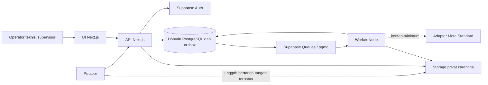

# Rancangan teknis tingkat tinggi

TECH-01 | 2026-10-20 | Status: Proposed / research-based

[Other language / Bahasa lain](../../en/04-technical/high-level-design.md)

Daftar isi: [Rekomendasi dan cakupan](#rekomendasi-dan-cakupan) · [Komponen dan batas kepercayaan](#komponen-dan-batas-kepercayaan) · [Perbandingan stack](#perbandingan-stack) · [Keputusan kegagalan dan deployment](#keputusan-kegagalan-dan-deployment) · [Ketergantungan dan tindakan berikutnya](#ketergantungan-dan-tindakan-berikutnya)

## Rekomendasi dan cakupan

Gunakan monolit modular TypeScript Next.js untuk UI dan `/api/v1`, worker Node terpisah, serta Supabase Auth, PostgreSQL, dan Storage privat. Dua layanan container terkelola memisahkan job AI lambat dari permintaan. Modul berbagi repositori dan model domain; ini pemisahan deployment, bukan arsitektur microservices. Rekomendasi bergantung pada spike teknis dan keahlian tim yang belum divalidasi.

Sasaran awal adalah satu site gedung komersial Indonesia dan 2-4 kategori pemeliharaan korektif non-darurat. Produk mendukung intake bukti dan penutupan yang diverifikasi supervisor. Produk tidak menggantikan ERP/CMMS atau menentukan keamanan fisik. Tampilkan panduan darurat site sebelum unggah, terlepas dari AI.

## Komponen dan batas kepercayaan

| Modul | Tanggung jawab | Batas |
| --- | --- | --- |
| Intake | Report, sesi, tanda terima | Kredensial publik dibatasi untuk satu intake |
| Pengelolaan kerja | Ticket, assignment, penjaga status, verification | Anggota terkini, tenant, dan site diperiksa per perintah |
| Bukti | Izin unggah, validasi, akses | Tanpa bucket publik atau rahasia penyedia di peramban |
| Bantuan AI | Draf berversi dan evaluasi | Tidak dapat menugaskan, menutup, atau menimpa keputusan manusia |
| Integrasi | Outbox, notifikasi, CSV | Kegagalan eksternal tidak membatalkan pekerjaan yang diterima |

Lakukan otorisasi dalam lapisan akses data khusus server yang digunakan SSR, Route Handlers, dan Server Actions. Halaman terlindungi tidak melindungi mutasi langsung. Kembalikan DTO minimum sesuai [panduan Next.js](https://nextjs.org/docs/app/guides/authentication) (T-01). Terapkan [panduan SSR Supabase](https://supabase.com/docs/guides/auth/server-side/nextjs) (T-02) untuk klaim terverifikasi dan penyegaran cookie; jangan simpan respons terautentikasi di cache bersama.

## Perbandingan stack

| Kandidat | Manfaat | Konsekuensi | Keputusan |
| --- | --- | --- | --- |
| Next.js + Node + Supabase | Tipe bersama dan satu bahasa runtime | Keahlian tim, ekstensi, serta kompatibilitas hosting belum diketahui | Pilihan acuan setelah spike |
| Next.js + FastAPI + PostgreSQL | Pustaka khusus Python | Dua runtime dan duplikasi validasi/operasi | Tinjau untuk kebutuhan produksi khusus Python |
| Serverless hanya dalam permintaan | Permukaan deployment kecil | Pekerjaan model/media panjang dan retry melampaui permintaan | Pertahankan worker tahan lama |
| Microservices + Redis | Skalabilitas terpisah | Lebih banyak layanan, rahasia, dan jenis kegagalan | Tunda sampai kebutuhan terukur |

Evaluasi [Supabase Queues](https://supabase.com/docs/guides/queues) (T-05), berbasis pgmq, sebelum membuat antrean sendiri. Klaim pengantarannya berlaku dalam jendela visibilitas; efek samping tetap memerlukan idempotensi lintas retry. Validasi enqueue transaksional dan ketersediaan ekstensi; gunakan rekonsiliasi outbox.

## Keputusan kegagalan dan deployment

Penyimpanan report berhasil meski AI mengantre atau gagal; operator dapat melakukan triase manual. Unggahan belum lengkap atau dikarantina tidak memenuhi bukti penyelesaian. Simpan perubahan tiket, event tetap, dan outbox dalam satu transaksi, dengan panggilan eksternal setelah commit. Pisahkan data demo sintetis, fixture staging, dan data pilot.

Singapura adalah kandidat karena [Render mencantumkannya](https://docs.render.com/regions) (T-10). Kedekatan layanan, ketersediaan Supabase, ketentuan transfer, dan persetujuan pelanggan tetap menjadi gerbang. Tetapkan versi setelah pemeriksaan kompatibilitas. Lihat [kontrak](api-and-event-contracts.md), [keamanan](security-privacy-and-governance.md), dan [biaya](infrastructure-and-costs.md).

## Ketergantungan dan tindakan berikutnya

E memiliki spike satu hari yang mencakup SSR terverifikasi, penolakan lintas tenant, unggahan privat, job transaksional, restart worker, dan alur manual cadangan. P memperoleh kebutuhan pemilik data; A memverifikasi akses akun penyedia. Catat hasil dalam [keputusan arsitektur](architecture-decisions.md). Jika akses gagal, gunakan AI simulasi berlabel jelas pada data sintetis untuk demo; jangan mengklaim integrasi langsung.
