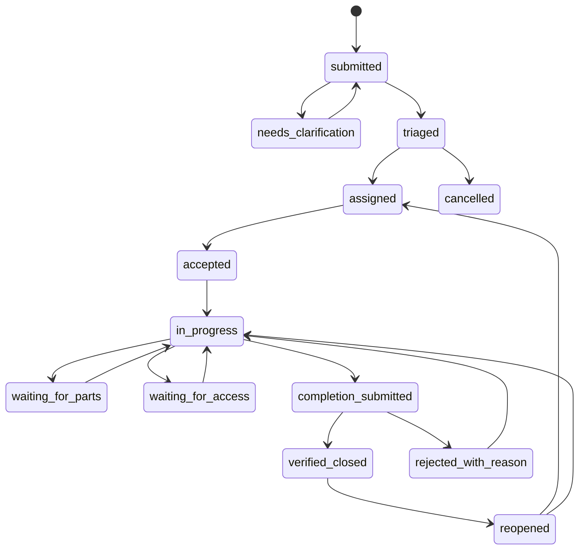

# Mesin status dan izin

TECH-03 | 2026-10-20 | Status: Proposed / research-based

[Other language / Bahasa lain](../../en/04-technical/state-machine-and-permissions.md)

Daftar isi: [Keputusan](#keputusan) · [Syarat transisi](#syarat-transisi) · [Izin](#izin) · [Perilaku konflik dan kegagalan](#perilaku-konflik-dan-kegagalan) · [Ketergantungan dan tindakan berikutnya](#ketergantungan-dan-tindakan-berikutnya)

## Keputusan

Gunakan pengenal status pekerjaan di bawah secara persis. Status AI dan unggahan merupakan sumbu terpisah. Duplikat adalah relasi, bukan status terminal. Hanya penerimaan supervisor menghasilkan `verified_closed`; kiriman teknisi dan keluaran model tidak dapat melakukannya. Ini usulan alur kerja, bukan sertifikasi keamanan.

## Syarat transisi

| Dari | Ke | Aktor dan syarat wajib |
| --- | --- | --- |
| submitted | needs_clarification | Operator; konteks hilang spesifik dan pertanyaan |
| needs_clarification | submitted | Operator setelah respons; pengamatan asli dipertahankan |
| submitted | triaged | Operator; lokasi manual, kategori, prioritas, ringkasan ditinjau |
| triaged | assigned | Operator; teknisi aktif pada site sama |
| assigned | accepted | Teknisi terkini yang ditugaskan, ID penugasan |
| accepted | in_progress | Teknisi ditugaskan, konfirmasi mulai |
| in_progress | waiting_for_parts / waiting_for_access | Teknisi ditugaskan, alasan dan waktu tinjau berikutnya |
| waiting_for_parts / waiting_for_access | in_progress | Teknisi ditugaskan, catatan melanjutkan |
| in_progress | completion_submitted | Teknisi ditugaskan, bukti penyelesaian ready dan catatan |
| completion_submitted | verified_closed | Supervisor, upaya terkini yang menunggu, bukti ditinjau, alasan keputusan |
| completion_submitted | rejected_with_reason | Supervisor, alasan dan koreksi yang diminta |
| rejected_with_reason | in_progress | Teknisi ditugaskan mengakui penolakan |
| verified_closed | reopened | Supervisor, alasan dan referensi verifikasi sebelumnya |
| reopened | assigned | Operator, penugasan baru/diperbarui |
| reopened | in_progress | Supervisor, teknisi aktif yang ada mengonfirmasi ketersediaan |

Pembatalan juga diizinkan dari submitted, needs_clarification, triaged, assigned, accepted, in_progress, waiting_for_parts, waiting_for_access, rejected_with_reason, dan reopened. Operator/supervisor memberi alasan, mengakhiri penugasan aktif, dan memicu notifikasi. Dari completion_submitted, tolak dahulu; dari verified_closed, buka ulang dahulu. Diagram menghilangkan sisi pembatalan tambahan ini agar mudah dibaca.

Penugasan ulang adalah perintah terpisah yang diizinkan dari assigned, accepted, in_progress, kedua status menunggu, rejected_with_reason, dan reopened. Perintah mengakhiri penugasan lama secara atomik dan mengubah status menjadi assigned. Teknisi lama segera kehilangan kewenangan menulis. Penyelesaian yang menunggu memblokir penugasan ulang hingga supervisor memutuskan upaya tersebut.

## Izin

| Operasi | Pelapor | Operator | Teknisi ditugaskan | Supervisor | Admin tenant |
| --- | --- | --- | --- | --- | --- |
| Kirim report | Scope intake | Ya | Sebagai anggota | Ya | Ya |
| Lihat | Report sendiri yang disaring | Scope site | Kerja ditugaskan | Scope site | Scope site |
| Triase, kait duplikat, tugaskan | Tidak | Ya | Tidak | Ya | Peran operator eksplisit |
| Progres dan penyelesaian | Tidak | Tidak | Ya | Hanya bila ditugaskan terpisah | Tanpa hak otomatis |
| Verifikasi, tolak, buka ulang | Tidak | Tidak | Tidak | Ya | Peran supervisor eksplisit |
| Anggota, pengaturan retensi | Tidak | Tidak | Tidak | Tidak | Ya, diaudit |
| Ekspor | Tidak | Izin site eksplisit | Tidak | Izin site eksplisit | Izin ekspor eksplisit |

Utamakan orang berbeda untuk memverifikasi kerja. Jika jumlah staf tidak memungkinkan pemisahan, catat verifikasi sendiri sebagai pengecualian dan sepakati dengan pemilik pilot. Laporkan terpisah dan jangan menyebutnya verifikasi independen. Administrasi tenant tidak menyiratkan kewenangan verifikasi pekerjaan.

## Perilaku konflik dan kegagalan

Setiap perintah menyertakan `expectedRevision`. Perintah usang mengembalikan 409 dan revisi/tindakan terkini tanpa menerapkan diam-diam keputusan pengguna yang telah berubah. Penerimaan/penolakan bersamaan atas satu penyelesaian menghasilkan satu keputusan ter-commit. Upaya ditolak yang tetap tidak dihapus; koreksi menghasilkan upaya baru.

Hasil AI terlambat menjadi saran berlabel revisi input. AI gagal tidak mengubah status kerja dan mengizinkan triase manual. Klarifikasi pelapor tidak mengubah status sebelum tinjauan operator. Token tidak dapat membuka ulang atau menugaskan. Token gagal/kedaluwarsa mengembalikan respons tidak tersedia yang sama tanpa mengonfirmasi keberadaan tiket. Unggahan gagal tidak dapat menjadi bukti atau memicu penyelesaian.

## Ketergantungan dan tindakan berikutnya

E memusatkan penjaga; Q menyiapkan skenario setiap transisi diizinkan dan aktor terlarang. P mengonfirmasi kewenangan site untuk verifikasi, pembatalan, dan persetujuan pengecualian. [Kontrak API](api-and-event-contracts.md) harus menyediakan perintah, bukan patch status tanpa batas. Tinjauan penerimaan wajib mencakup penolakan, kirim ulang, reopen, penugasan ulang, dan perintah berbenturan, selain alur normal.
