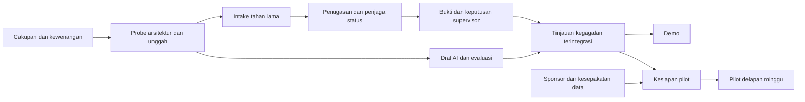

# Rincian kerja dan estimasi

DEL-02 | 2026-10-20 | Status: Proposed / research-based

[Other language / Bahasa lain](../../en/05-delivery/work-breakdown-and-estimates.md)

Daftar isi: [Dasar estimasi](#dasar-estimasi) · [Beban demo empat peran](#beban-demo-empat-peran) · [Cakupan dua orang](#cakupan-dua-orang) · [Jalur kritis dan upaya pilot](#jalur-kritis-dan-upaya-pilot) · [Ketergantungan dan tindakan berikutnya](#ketergantungan-dan-tindakan-berikutnya)

## Dasar estimasi

Semua upaya adalah asumsi perencanaan analis, bukan penawaran delivery atau kecepatan tim teramati. Asumsikan lima jam proyek fokus per orang tersedia per hari kerja, dengan rapat dan gangguan biasa di luar blok itu. Sepuluh hari menghasilkan 50 jam/orang: 100 untuk dua orang atau 200 untuk empat. Ketersediaan, keahlian, dan komponen yang ada belum diketahui. Estimasi ulang setelah probe arsitektur/penyedia.

## Beban demo empat peran

| Paket kerja | Jam P | Jam E | Jam A | Jam Q | Dependensi |
| --- | --- | --- | --- | --- | --- |
| Cakupan, izin, cerita sintetis | 8 | 2 | 0 | 4 | Mulai |
| Spike arsitektur/penyedia | 0 | 6 | 4 | 2 | Cakupan |
| Intake dan unggahan privat | 0 | 10 | 2 | 4 | Spike |
| Alur manual dan penutupan terverifikasi | 2 | 10 | 0 | 6 | Domain dan intake |
| Draf AI dan evaluasi | 2 | 4 | 18 | 4 | Bukti ready + penyedia |
| Relasi duplikat, tanda terima, dashboard minimum | 2 | 4 | 4 | 4 | Alur kerja |
| Tinjauan kegagalan, privasi, penerimaan | 2 | 4 | 4 | 10 | Alur terintegrasi |
| Paket demo, persiapan pembeli/pilot | 16 | 2 | 2 | 2 | Bukti dan latihan |
| Total | 32 | 42 | 34 | 36 | 144 jam fokus |

Pada 50 jam per peran, cadangan P18/E8/A16/Q14 = 56 jam. Delapan jam E, bukan total cadangan, membatasi jalur teknis. Usulan rentang ketidakpastian 120-200 jam total tidak berarti pemilik boleh melampaui 50. Jika E perlu 60, jadwal bergeser atau cakupan berubah meskipun P memiliki waktu luang. Bantuan lintas peran memerlukan keahlian nyata dan biaya serah terima.

## Cakupan dua orang

Gabungkan P+Q dan E+A. Tabel penuh membebani mereka 68 dan 76 jam, melampaui 50 masing-masing. Rencana diperkecil menargetkan 40 dan 44 jam, menyisakan cadangan 10 dan enam jam.

| Kerja teknis diperkecil | Jam E+A | Kerja produk/kualitas diperkecil | Jam P+Q |
| --- | --- | --- | --- |
| Spike | 6 | Cakupan, izin, fixture sintetis | 8 |
| Jalur intake/foto privat | 10 | Tinjauan alur mobile dan bahasa | 8 |
| Status, tugas, bukti, review | 14 | Tinjauan penerimaan kegagalan/akses | 12 |
| Satu jalur draf AI dengan cadangan | 4 | Paket demo, pembeli, kesiapan pilot | 12 |
| Relasi duplikat manual | 2 | Total | 40 |
| Tanda terima terbatas/hitungan minimum | 4 | | |
| Koreksi kegagalan | 4 | | |
| Total | 44 | | |

Ini demonstrasi sintetis sempit dengan dua kategori. Tunda ranking duplikat otomatis, analitik kaya, channel notifikasi luas, integrasi, suara, segmentasi, dan setup pemulihan produksi. Tinjauan manusia, media privat, akses terbatas, bukti, serta tolak/reopen tetap inti. Jika jalur AI nyata tidak muat, beri label simulasi dan catat gerbang integrasi belum terpenuhi; jangan menyiratkan kesiapan produksi.

## Jalur kritis dan upaya pilot

Kesiapan tambahan setelah demo: P16-30, E40-70, A12-24, Q24-40 jam, total 92-164. Ini mencakup RBAC nyata, privasi/hapus, latihan restore, waktu, notifikasi, pelatihan, dan koreksi. Pada 25 jam fokus/peran/minggu, E saja memerlukan 1,6-2,8 minggu kerja, sebelum waktu tunggu berurutan. E+A dua orang memerlukan 52-94 jam atau 2,1-3,8 minggu pada kapasitas itu. [Roadmap 90 hari](implementation-roadmap.md) layak hanya dekat asumsi menguntungkan; jika tidak, geser awal dan pertahankan pilot penuh delapan minggu.

Perencanaan dukungan/pengukuran pilot: P3-5, E2-4, A2-3, Q4-6 jam/minggu, total 11-18 atau 88-144 selama delapan minggu. Tenaga operator/teknisi/supervisor pelanggan tambahan dan harus diukur terpisah. Gaji, opportunity cost, pajak, dan tarif kontraktor belum diketahui; upaya kali tarif terkonfirmasi adalah persamaan biaya, bukan payroll rekaan.

Kesiapan ditambah dukungan/pengukuran delapan minggu berjumlah 180-308 jam, di luar demo 144 jam. Pada asumsi eksplisit Rp100.000/jam, biaya tenaga/opportunity cost Rp18.000.000-30.800.000. Ditambah skenario biaya layanan tunai dua bulan Rp3.880.000 dari model bisnis menghasilkan Rp21.880.000-34.680.000 sebelum biaya lain, menyisakan kebutuhan dana Rp16.880.000-29.680.000 dibanding uji biaya pilot Rp5.000.000. Ini keputusan pembelajaran/investasi, bukan klaim margin. Pisahkan investasi produk dapat dipakai ulang dari delivery khusus pelanggan dan jangan menghitung ganda baris staf tumpang tindih. Sensitivitas komersial sempit 28 jam tidak mendanai rencana penuh ini. Lihat [ekonomi unit](../02-business/unit-economics-and-costs.md).

## Ketergantungan dan tindakan berikutnya

P mencatat ketersediaan bernama dan cakupan keahlian. E menguraikan hasil spike menjadi tugas tersisa; Q mencatat bukti penerimaan, bukan persentase tiket selesai. Tinjau beban pemilik dan dependensi penghambat hari 2/5/8, lalu sebelum pilot. Sediakan satu peninjau penerimaan; kurangi cakupan opsional sebelum menghabiskan kerja pemulihan/keamanan. Lihat [RACI](team-and-raci.md) dan [risiko](risk-register.md).
